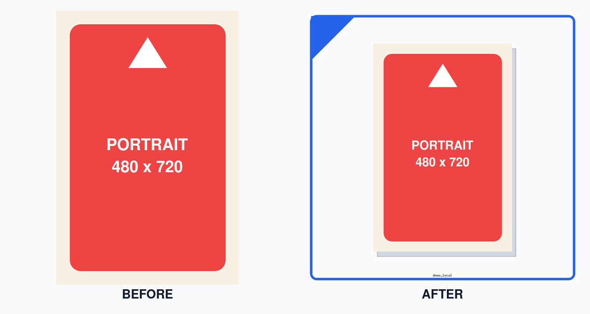

# product-image-batcher

یک پنل وب کوچک برای قرار دادن گروهی عکس‌های محصول در یک قاب ثابت و تحویل نتیجه به‌صورت ZIP. فایل‌ها یکی‌یکی به سرور محلی فرستاده می‌شوند؛ نسبت تصویر حفظ می‌شود و خروجی هر فایل یک JPEG مربع ۱۰۰۰×۱۰۰۰ است.

## پیش‌نیاز

- Docker Desktop یا Docker Engine همراه Docker Compose

## نصب و اجرا

```bash
docker compose up --build -d
```

سپس `http://localhost:8080` را باز کنید، عکس‌ها را بکشید و روی **Process Images** بزنید.

برای اجرای قابل‌تکرار سه تصویر نمونهٔ عمودی، افقی و مربعی:

```bash
docker compose exec -T web php scripts/demo.php http://127.0.0.1:8000 http://localhost:8080
```

این دستور آدرس ZIP را چاپ می‌کند. فایل روی دیسک نیز در `outputs/<batch-id>/product-images.zip` قرار می‌گیرد. در اجرای اندازه‌گیری‌شدهٔ همین سه نمونه، ۳ فایل موفق و ۰ فایل ناموفق در ۲٫۴۶۲ ثانیه پردازش شدند؛ این عدد فقط گزارش همان اجراست، نه تضمین ظرفیت.

## قالب و پردازش

قاب عمومی فایل شفاف `assets/template-overlay.png` است؛ آن را با PNG شفاف ۱۰۰۰×۱۰۰۰ خودتان جایگزین کنید. رنگ پس‌زمینه، سایه، کیفیت JPEG، محدودیت ابعاد و مدت نگهداری خروجی در `config.php` هستند. برای نوشتهٔ فارسی در پایین قاب، یک فونت TTF با نام `assets/font.ttf` اضافه کنید.

ورودی‌های JPEG، PNG و WebP با روش `contain` و بدون کشیدگی یا برش در قاب جا می‌گیرند. جهت EXIF فایل JPEG اصلاح می‌شود. نام تکراری با پسوند عددی ذخیره می‌شود و UI تعداد موفق/ناموفق را نشان می‌دهد. پردازش ترتیبی است و همهٔ تصاویر هم‌زمان در حافظه decode نمی‌شوند.

محدودیت پیش‌فرض هر آپلود ۲۵ مگابایت و هر تصویر ۲۴ میلیون پیکسل است. سرور داخلی PHP برای اجرای محلی و دمو است؛ برای انتشار عمومی اینترنتی باید وب‌سرور، احراز هویت، HTTPS و سیاست پاک‌سازی مناسب اضافه شود. پاک‌سازی خروجی‌های قدیمی را می‌توان با این دستور اجرا کرد:

```bash
docker compose exec -T web php cleanup.php
```

مجوز: MIT
